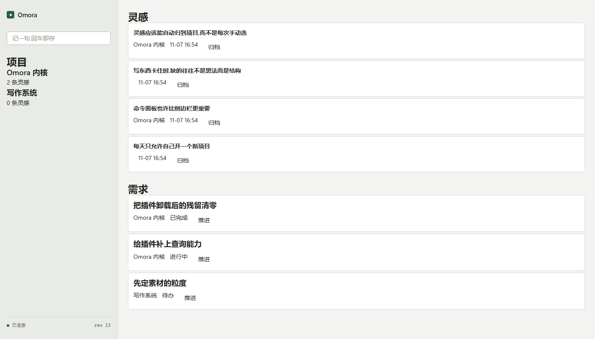
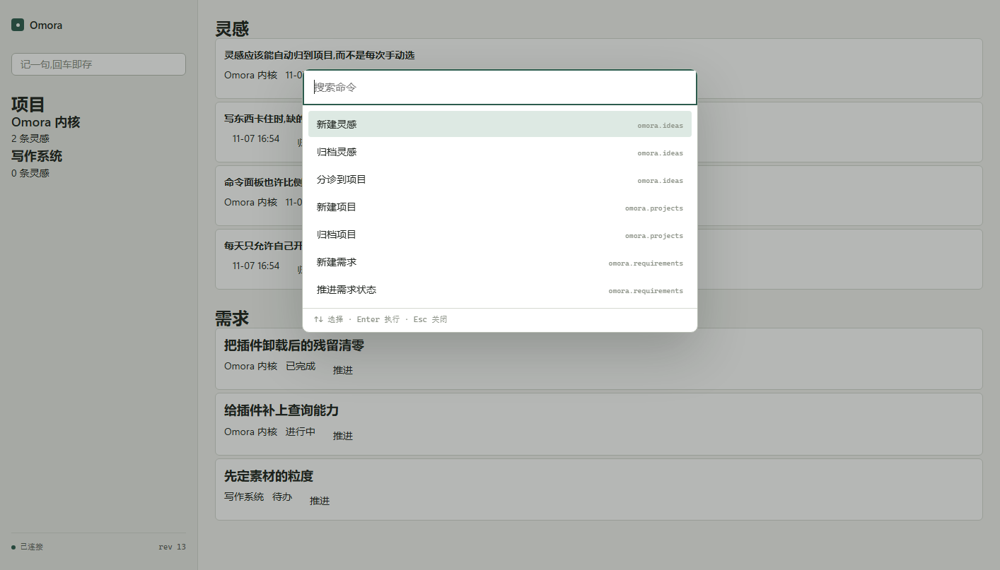

# Omora

> 当前代号，暂不对外定名。本地优先的灵感与项目管理工具：随手捕捉、随手分诊，让「念头 → 项目 → 需求」连成一条可回溯的线。



## 现在能做什么

- **捕捉**：侧边栏一条输入框，回车即存，不打断手上的事
- **收件箱**：主区按时间列出灵感，可归档
- **分诊**：把灵感挂到项目上（经插件间的服务调用完成校验）
- **项目与需求**：项目清单 + 需求列表，需求状态在 todo / doing / done 之间流转
- **命令面板**：⌘/Ctrl + K，命令来自所有已激活的插件，按标积分词过滤



## 跑起来

```bash
# 1. 准备（一次）
uv sync --all-packages --all-groups
cd web && pnpm install && cd ..

# 2. 启动内核（终端 1）
uv run python -m omora_kernel --database .omora/dev.sqlite --plugins plugins

# 3. 启动界面（终端 2）
cd web && pnpm dev            # 打开 http://localhost:5173
```

想先看到内容，而不是空白收件箱：

```bash
uv run python scripts/seed_demo.py --url ws://127.0.0.1:8765
```

验收（对着真实运行的内核）：

```bash
uv run python scripts/accept_p0.py --url ws://127.0.0.1:8765   # 垂直切片
uv run python scripts/accept_p1.py --url ws://127.0.0.1:8765   # 捕捉 → 分诊 → 需求 → 状态
```

## 这是什么架构

三个很小的核心 + 一大堆插件：

- **内核**（Python）只管逻辑、存储、事件、权限与插件宿主，**不认识任何业务概念**；
- **渲染层**（TypeScript）只管把节点树画出来，**不认识任何业务概念**；
- 两者之间只有协议：C1（内核 ↔ 前端）、C2（宿主 ↔ 插件）、C3（插件 ↔ 渲染器）。

灵感、项目、需求这些词，只出现在 `plugins/` 里。官方插件与第三方插件走同一扇门，没有后门——`plugins/ideas` 和 `plugins/projects` 之间也只能通过事件与服务通信。

想加功能？[写一个插件](docs/plugins/authoring.md)——两个文件、三十行，不需要改内核。

细节：[架构总览](docs/architecture/overview.md) · [三份契约](docs/architecture/contracts.md) · [核心边界](docs/architecture/core-surface.md)

## 写代码之前

门禁是唯一入口，本地与 CI 同一条命令：

```bash
uv run python scripts/check.py
```

23 个阶段：仓库卫生、体量预算、契约生成物一致性、格式化、lint、类型、测试、架构边界、构建。规则见 [工程纪律](docs/engineering/discipline.md)，AI 的根规则见 [AGENTS.md](AGENTS.md)。

## 状态

P0 垂直切片完成，P1 进行中（见 [P1 计划](docs/roadmap/p1.md)）。当前只有本地形态：桌面壳、服务器部署、同步、移动端都还没做。

文档索引：[docs/README.md](docs/README.md)
